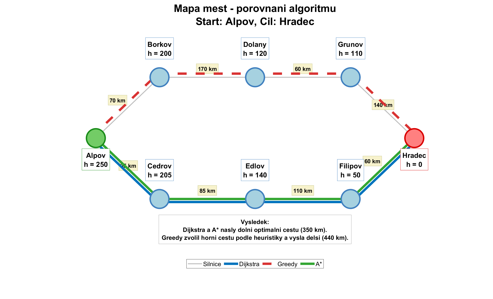
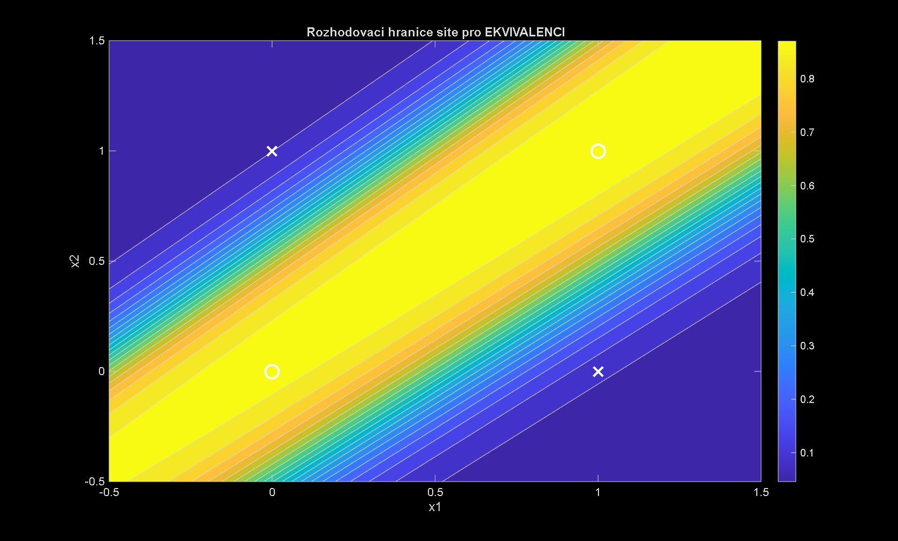

# Umělá inteligence – algoritmy v MATLABu

Cvičení z předmětu **Umělá inteligence** (VŠPJ, LS 2025/26). Každé cvičení obsahuje vlastní implementaci algoritmu, experimenty a grafy výsledků.

| Složka | Téma | Algoritmy |
|---|---|---|
| `cv02-prompt-engineering` | generování kódu pomocí LLM a jeho ověření testy | rozklad na prvočinitele |
| `cv02-svet-vysavace` | agent ve světě vysavače | reflexní agent, PEAS, simulace |
| `cv03-prohledavani` | neinformované prohledávání | **BFS, DFS**, stavový prostor |
| `cv04-astar` | informované prohledávání | **A\***, Dijkstra, greedy search, heuristiky pro 8-puzzle |
| `cv05-optimalizace` | lokální optimalizace | **gradientní sestup** (lineární regrese), **hill climbing** (8 dam) |
| `cv06-hry` | hry dvou hráčů | **minimax**, **Monte Carlo Tree Search** (piškvorky) |
| `cv07-logicti-agenti` | znalostní agenti | Miny a **Wumpus world** – báze znalostí a odvozování |
| `cv08-klasifikace` | strojové učení | porovnání klasifikátorů (Classification Learner), matice záměn |
| `cv09-neuronove-site` | neuronové sítě od nuly | **perceptron**, XOR, **backpropagation** |
| `cv10-deep-learning` | hluboké učení | předtrénovaná CNN, **transfer learning** |
| `cv13-experimenty-bludiste` | týmový výzkumný projekt | BFS vs DFS vs A\* – 5 experimentů (hustota, velikost, heuristiky) |

<p>
  
  
</p>

## Technologie

MATLAB · Deep Learning Toolbox · Statistics and Machine Learning Toolbox

## Jak spustit

V MATLABu otevřít složku cvičení a spustit hlavní skript (`cvNN_ulohaN.m`), např.:

```matlab
cd cv04-astar/ukol2_mapa
cv04_uloha2
```

Každá složka má vlastní `README.txt` s popisem úlohy a výsledků.

## Poznámky

- `cv10`: vlastní datová sada obrázků pro transfer learning není součástí repozitáře (obrázky z internetu).
- `cv13` je týmová práce dvou studentů, zveřejněno se souhlasem spoluautora.

---
*Historie commitů odpovídá datům odevzdání v Moodlu (včetně opravených verzí „update“).*
